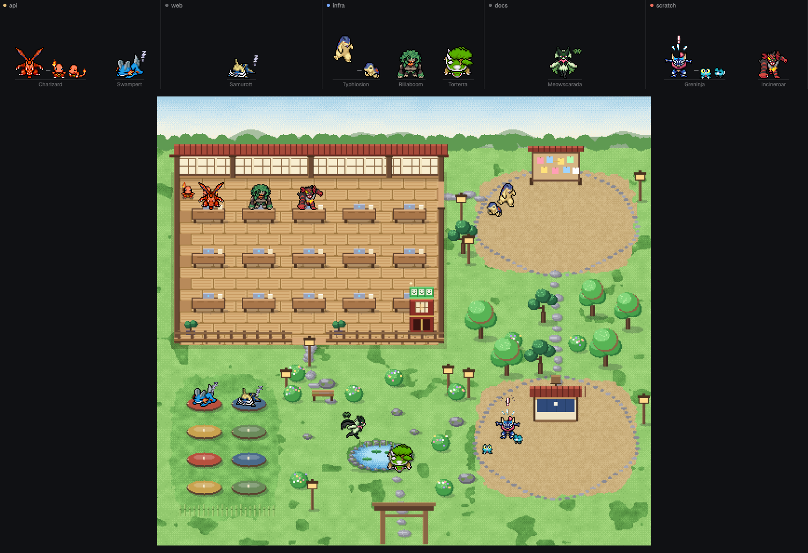

# Pokémon Workers

A [Herdr](https://herdr.dev) mod where every agent is a starter Pokémon. A strip across the top of the window shows one
cell per space; **Campus** opens a place where all of them live: working ones sit at a desk, idle ones wander the park,
tired ones sleep on a mat, finished ones wait at the notice board, blocked ones call from the help stall.



- **One animal per agent, a small one per sub-agent.** An agent is the final form of a starter line (Charizard,
  Greninja, Meowscarada...), its sub-agents are the first form of the same line (Charmander, Froakie...). All nine
  generations, grass, fire and water, plus Pikachu (with Pichu) and the Eevee family (every evolution, with Eevee): 36 lines.
- **Random, and it sticks.** A new agent is dealt a random line (a group nobody on screen has yet, if there is one; the Eevee family counts as one group) and keeps it.
- **Status you can read at a glance**
  - working: busy, shaking over its work
  - idle: standing; after 90 seconds of nothing it curls up asleep with a floating Z
  - done: jumping up and down until you look at it
  - blocked: flinching under a red "!"
- **Click an animal** to jump to its agent. **Right-click a cell** to add an agent (or a plain terminal) to that space.
- **Five scenes** (Zen garden, Meadow, Greenhouse, Snow lodge, Beach hut), switchable in the Campus. The scene darkens
  and warms with your computer's clock: dawn, day, dusk, night.
- The campus grows with your agents: it has room for 8, 16 or 32.

## Install

1. Copy the `mods/pokemon-workers` folder into your Herdr app folder's `mods/` (`~/.config/herdr-app/mods/`). The folder
   must keep the name `pokemon-workers`: it loads its pictures by that path. Herdr docks a strip on top of the window the
   first time it sees it.
2. Optional keys: merge `keys.json` into yours (`alt-shift-w` opens the campus, `alt-shift-s` changes scene). Herdr's
   [mod guide](https://herdr.dev/gallery/?type=mods#share) says to ask before replacing keys you already use.
3. `herdr-app check ~/.config/herdr-app/mods/pokemon-workers`

You can also point your agent at this repository and have it add the mod the way Herdr's `AGENTS.md` describes.

## What it touches

Read this before you install, as Herdr advises for any mod:

- **Network.** The first time an animal is needed it downloads that species' sprite sheets and credits from
  `raw.githubusercontent.com` (the PMD SpriteCollab repository) with `curl`. Nothing else is fetched, and nothing about
  you or your agents is sent anywhere. Roughly 50 to 100 KB per species.
- **Programs.** It runs `curl` and nothing else. You need `curl` on your PATH.
- **Files.** It writes to `<Herdr app folder>/data/pokemon-workers/` (the downloaded sheets and the GIFs it cuts from
  them) and reads its own folder. It remembers which animal each agent has, and the scene, in Herdr's shared state.
- **Commands it runs:** `pane.focus` and `agent.focus`, when you click an animal; `tab.new`, when you pick something in the right-click menu. It also asks Herdr which agents are installed (`knownAgents`), the same list the built-in "+" menu uses.

## Art and licenses

The Pokémon art is **not in this repository**: it is downloaded to your computer when needed, from
[PMD SpriteCollab](https://github.com/PMDCollab/SpriteCollab) (CC BY-NC 4.0, credit kept). The **Credits** button in the
mod lists the artists of the sprites you are using. This is a non-commercial fan project, not affiliated with Nintendo,
Game Freak, Creatures, Spike Chunsoft or SpriteCollab. Details and what was changed: [NOTICE.md](NOTICE.md).

The code and the campus scenes are MIT licensed ([LICENSE](LICENSE)).

## Try it without agents

Open the mod in a tab with made-up data:

```sh
herdr-app do tab.new '{"name":"pw","mod":"pokemon-workers","props":{"demo":true}}'
```

`tools/dev-install.sh` copies the mod into your Herdr app folder without docking it, for development.

## How it is built

See [RECIPE.md](RECIPE.md). `tools/` holds what produced the bundled pictures:

| Script | What it does |
|---|---|
| `tools/make-starters-html.mjs` | builds `prototype/strip_starters.html`, the browser prototype the scenes are baked from |
| `tools/export-hook.js`, `tools/unpack-export.mjs` | bake the five scenes at three sizes into `mods/pokemon-workers/scenes/` and the layout data into `campus.json` |
| `tools/fetch-starters.mjs`, `tools/measure-starters.mjs` | download the sprites for the prototype into `starters/` (git-ignored) |
| `tools/build-fx.mjs`, `tools/make-fx-gifs.mjs` | the effect animations, from pixelfx |
