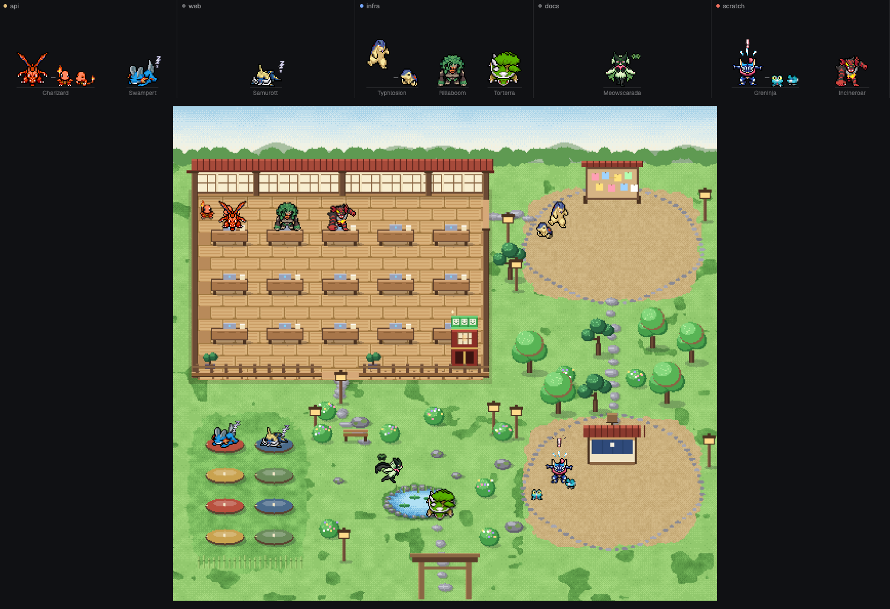

# Pokémon Workers

A strip across the top of the Herdr window with one equal-width cell per space. Every agent in a space is a starter
Pokémon (the last stage of a line) that acts out its status; an agent's sub-agents stand beside it as the first stage
of the same line, joined by a short line. A **Campus** button opens a full picture of a place where all the animals live
and walk around.

## What you see

**The strip** (`mod.json`: `{ "place": "top", "size": 168 }`, theme colors throughout):

- One cell per space, left to right, each `flex_1` with a 1px `border` line on its right. The cells are ordered: the space you are working in (the shown
  space) first, then blocked, done, working, and idle last (same order inside a status as Herdr lists them). The shown space
  has a 1px `accent` frame; inside it the focused agent is first and has a soft light behind its animal (three
  concentric ellipses, `#ffe08a` at 11%, 18% and `#fff3c0` at 28%, the largest about 2.1x the animal's width, pulsing in opacity
  between 60% and 100% every 2.2 s).
- Each cell is painted like a small outdoor scene, by its status: three sky bands over a 3px grass line, a 2px grass edge and a
  22px plank floor the animals stand on, with their names on it. working: bright day with a sun. idle: evening. done: sunset low on
  the horizon. blocked: red dusk. All asleep or no agents: night with a moon and stars.
- At the far right a 76px column with a 1px left border holding two outlined buttons, **Campus** and **Credits** (11px text,
  6px radius, `border` outline, `muted` text, `hover` background).
- Each cell: a 22px header with a 6px dot in the space's status color (`blocked`, `done`, `working`, `idle`, else `dim`),
  the space name (11px, light, truncated) and, when the space has more than three agents, `+N` (10px, `dim`).
- Under the header, the animals stand on a 1px `border` line, bottom aligned, spread evenly. At most three agents per
  cell, the most urgent first (blocked, done, working, idle). Each stands in a column: the animal, the ground line,
  then its species name (10px, `dim`; on hover `foreground` and `Species · program`).
- An agent's sub-agents are drawn smaller, to its right, at most two, then `+N`. An 8px by 1px `dim` line floats 16px above
  the ground between the agent and its first sub-agent (a leash). Sub-agents are the first stage of the agent's line.
- A working big animal has a small laptop in front of it (36 x 26 px GIF, `fx/laptop.gif`, seen from behind: the screen faces the animal, with a breathing logo).
- A space with no agent shows a Poké Ball (44 x 32 px GIF, `fx/ball.gif`) standing in the middle of the floor. It stays still
  for 0.9 s, rocks left and right twice (about 0.1 s a step, up to 22 degrees about its bottom), stays still for 1.3 s, and
  repeats, like a capture in progress. With no spaces: "No spaces yet."
- The pictures are animated GIFs, drawn at 2 screen pixels per source pixel times a per-species factor, so every
  species stands about the same height (roughly 60 screen px for an agent, 36 for a sub-agent).
- While a species is still downloading, a grey rounded blob pulses in its place (opacity 0.25 to 0.7 every 900 ms).

**The campus** (a dialog, 94% by 92% of the window, background `popover`):

- A 40px top bar: "Campus", a summary (`9 agents · 3 working · 4 resting · 1 done · 1 need you · Dusk`), then five scene
  chips (the current one has an `accent` outline and `selected` background), **Credits** and **Close**.
- Below it, one picture scaled to fit (between 0.5x and 2x of the picture's own size), centered. It shows a walled
  place: a covered veranda with rows of desks at the top left, a notice board on a gravel plaza at the top right, a
  sleeping area with floor mats at the bottom left, a pond and benches in the middle, a help stall on a second plaza
  at the bottom right, a gate at the bottom middle, trees, lanterns and other plants around.
- Five scenes with the same layout: Zen garden (raked sand, maples, bamboo, stone lanterns), Meadow (grass, red roof,
  flowers), Greenhouse (white glass roof, palms, ferns), Snow lodge (snow, log walls, snowy pines), Beach hut
  (sand, thatched roof, palms, tiki torches).
- Time of day follows the computer's clock. At night (dark by about 19:30, light again by about 07:30) the scenery gets a deep blue
  wash of up to 50%, the lanterns (`lamps` in `campus.json`) light up with a warm glow (seven stacked ellipses, up to 46 px
  across at the scene's own scale), and a 11% veil covers the animals too. The wash is drawn between the scene and the animals,
  so the animals stay easy to see. Around 06:30 and 18:20 an orange wash up to 16% lies over the scenery. The top bar names the
  moment: Night, Dawn, Day or Dusk.

## How it behaves

The status of the agent decides the animal's animation (SpriteCollab animation names in brackets):

| Status | Animal |
|---|---|
| `working` | busy, shaking (`Charge`) |
| `idle` | standing (`Idle`). After 90 s without a change in its tab, or if nothing changed since the app started: lying asleep (`Sleep`) with a looping Z above it |
| `done` | jumping up and down (`Hop`), until the user looks at it (Herdr then makes it `idle`) |
| `blocked` | flinching (`Hurt`) with a red "!" popping above it |

Sub-agents use the same animations from their own status: `working` and `blocked` as above, anything else asleep; a
sub-agent is never `done`. A sub-agent with its own pane is shown as its agent's companion, not as a second agent.

- **Click an animal** (strip or campus): `pane.focus {pane}`, or `agent.focus {terminal}` for one without a pane. In the
  campus the dialog then closes.
- **Right-click a cell** (animals included): a small popup (230px wide) titled `Add to <space>` lists `Terminal` and every installed agent
  (from `knownAgents`, the list the built-in + menu uses). Picking one runs `tab.new {space, name, argv}` in that cell's space, not the shown one.
  Not available in demo mode.
- **Shiny:** every big animal and every small one rolls once, when it first appears, a 1 in 64 chance (`SHINY_ODDS` in
  `model.js`) of being shiny, each on its own, so a sub-agent can be shiny under a normal agent and the other way round. The
  roll is remembered either way (shared state `pokemon-workers`, `shiny`, key = pane id, or `k:` + the sub-agent's address;
  newest 300 kept). A shiny shows the shiny colours (SpriteCollab `sprite/<dex>/0000/0001/`) with a small twinkling star
  (`fx/shine.gif`, 22 x 22 px) at its upper left, and a big one has a "✦" before its name (strip and campus tooltip).
- **Which animal:** each agent is dealt a random line when it first appears, and keeps it. The draw is in two steps so a family
  counts once: a group, then a line in it. Every line is its own group except the eight Eevee evolutions, which are one group.
  So with 10 lines of which 4 are Eevee evolutions there are 7 groups, each 1/7, and each evolution 1/28 (in the real list: 29
  groups, each 1/29, each evolution 1/232). A group no agent has yet is preferred while there is one. The choice is saved under the pane id (or terminal address) in shared state `pokemon-workers`, newest 300 kept.
- **Campus movement:** each agent has a place for its status. `working`: a free desk. `done`: a spot in front of the
  notice board. `blocked`: a spot at the help stall. Asleep: a mat. Awake and `idle`: wanders to random points in the
  park, a new one every 5 to 13 s. Animals start at the gate, walk around obstacles (A* on a 6px grid, corners
  pulled tight) at 34 px/s (sub-agents 40), face the way they walk (toward, away, left or right, each its own drawn
  sprite), stop, and take the animation of their status. When all spots of a kind are taken they wait nearby.
  Sub-agents keep close beside their agent, finding their own way.
- The campus has three sizes (room for 8, 16 or 32 agents), picked from the number of agents; it changes as they grow.
- **Keys:** `pokemon-workers.campus` opens the campus; `pokemon-workers.scene` changes the scene (bound in `keys.json` to
  `alt-shift-w` and `alt-shift-s`). The scene chosen is saved in shared state.
- The Credits dialog (660 x 600) states where the art comes from, its license, what was changed, and lists the artists
  of the sprites currently in use with the license of each contribution.
- `props { demo: true }` shows made-up spaces and agents (api, web, infra, docs, scratch, and an empty notes); that is what `preview.png` shows.

## Built from

Files in `mods/pokemon-workers/`:

- `main.js`: the view. `props().campus` or `props().credits` choose the dialog views, otherwise the strip. Redraws on a
  500 ms timer only when what is shown changed (time can put an agent to sleep). Opens the dialogs with `openOverlay`.
- `model.js`: reads `spaces()`, `agents()` and `terminals()` (sub-agents are terminals whose `parent` is the agent's
  address) into plain data; deals lines (`ensureLines`) and keeps them with `shared`/`setShared`.
- `lines.js`: the 36 lines (27 starter lines, Pikachu with Pichu, and the eight Eevee evolutions with Eevee): `{ key, group?, kid: [dex, name], big: [dex, name] }`.
- `sprites.js`: downloads and prepares art. A sprite id is the dex number, or the number plus `s` for the shiny colours (cached in `sprites/<dex>s/`). Runs `exec("curl", ...)` for `AnimData.xml`, the `<Anim>-Anim.png` sheets of
  `Walk Idle Sleep Charge Hop Hurt` and `credits.txt` of a species from
  `https://raw.githubusercontent.com/PMDCollab/SpriteCollab/master/sprite/<dex, 4 digits>/`, plus `credit_names.txt`;
  stores them under `data/pokemon-workers/` with `fs/promises`; up to 4 species download at once. Cuts one GIF per
  animation and facing on demand (`<Anim>_<row>_v2.gif`, cached).
- `anim.js`, `png.js`, `gif.js`: no dependency other than `zlib` (`inflateSync`). `png.js` reads a PNG (8-bit, not
  interlaced). `anim.js` reads `AnimData.xml`, follows `CopyOf`, crops every facing to the visible pixels of its frames
  (so a GIF's bottom edge is the animal's feet and its middle its body, and animals stand on the same line whatever the
  animation), resizes by nearest neighbour and calls `gif.js`, a GIF89a writer (one palette of up to 255 colors, index 0
  transparent, frame delay from the sheet's durations at 1/60 s, loops forever). The size factor of a species comes from
  the height of its standing pose (target about 30 source px for agents, 18 for sub-agents, snapped to
  0.5 0.6 0.667 0.75 0.8 0.9 1 1.25 1.5, left alone within 0.88 to 1.15).
- `campus.js`: the campus. Loads `campus.json` (per size: width, height, `G` 6, the blocked grid run-length encoded, and
  points for desks, `reception` (the notice board), `help`, `mats`, the park rectangle and the gate), the scenes
  `scenes/<scene>_<8|16|32>.png` (drawn at 2 px per source pixel) and the effects `fx/sleep.gif`, `fx/alert.gif`.
  Each animal is a zero-size anchor element whose `left` and `top` have `transition(..., {duration: 170, easing: "linear"})`,
  moved every 170 ms; the picture hangs from it with its feet on the anchor. Back to front by y.
- `fx/ball.gif`, `fx/shine.gif`, `fx/laptop.gif`: drawn from shapes by `tools/make-ball-gif.mjs`, `tools/make-shine-gif.mjs` and `tools/make-laptop-gif.mjs` (no outside art).
- `scenes/`, `campus.json`, `fx/`: baked by the tools of this repository (`tools/export-hook.js` in the browser prototype)
  from the same code; the effects come from pixelfx (MIT).
- `mod.json`, and `keys.json` at the repository root.

`herdr` functions used: `agents`, `spaces`, `knownAgents`, `terminals`, `theme`, `run`, `props`, `shared`, `setShared`, `openOverlay`,
`closeOverlay`, `nextCommand`, `exec`, `appHome`, `readTextFile`. Programs run: `curl`. Network: `raw.githubusercontent.com`.

## Watch out

- **Do not rename the folder.** `image()` paths resolve from the app folder, so the scenes and effects are loaded as
  `mods/pokemon-workers/...`.
- `fetch` answers have no `arrayBuffer`/`blob`; binary files come from `curl` and `fs.readFile` (which returns a `Uint8Array`).
  `fs.writeFile` takes a `Uint8Array`. `fs.stat` does not exist.
- `frames(list, ms)` only cycles text. Animated pictures must be GIFs loaded with `image(path)`.
- GIFs must stay at or under 255 colors plus transparency.
- Raising `VERSION` in `sprites.js` rebuilds every cached GIF.
- Commands (`nextCommand`) reach every shown copy of the mod, so with the strip open in two places `scene` advances twice.
  Only the strip copy listens.
- Small animals only exist for terminals with a `parent` in `terminals()`, i.e. started by an agent with `hc run`. An agent program's
  in-process helpers (Claude Code's Agent tool) are not terminals and never show. Check with `herdr-app ls`: the agent's `sub_agents`.
- Sprites are not shipped. Keep it that way: bundling them would take on SpriteCollab's redistribution terms (see `NOTICE.md`).
- Some species lack some animations; the mod falls back to `Idle`.
- Beyond 32 agents the campus is crowded: spots run out and the rest wait near the last one.
- Animals can walk through each other (there is no animal-to-animal collision). Everything stands in front of the scenery
  (no part of a tree or a wall hides an animal).
- The sun and moon are not drawn; night is the color wash and the lantern light.

## Done when

- `herdr-app check mods/pokemon-workers` passes and `herdr-app status` shows no errors.
- With the mod docked on top, each space has a cell; every agent shows a species name under an animal, feet on the ground
  line; sub-agents are smaller and beside their agent with a short line.
- Changing an agent's status changes its animation within a second: working shakes, done jumps, blocked flinches with a "!",
  idle for 90 s lies asleep with a Z.
- Clicking an animal focuses its agent. Right-clicking a cell opens the add-agent menu for that cell's space.
- A first start with no data downloads sprites (needs `curl` and a connection), showing pulsing blobs until each is ready, and
  leaves GIFs under `data/pokemon-workers/sprites/<dex>/`. A second start downloads nothing.
- **Campus** opens; animals walk from the gate to a desk, the park, a mat, the notice board or the help stall according to their
  status, around obstacles; sub-agents follow; the five scene chips each change the picture; Close and Esc close it.
- **Credits** lists artists for the sprites in use once they are downloaded.
- A new agent gets an animal and keeps it after restarting Herdr.
- `props { demo: true }` in a tab shows six cells with made-up agents (a shiny Charizard and a shiny Pichu among them); the last one is empty and shows the Poké Ball.
